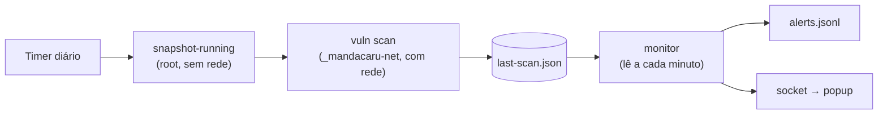
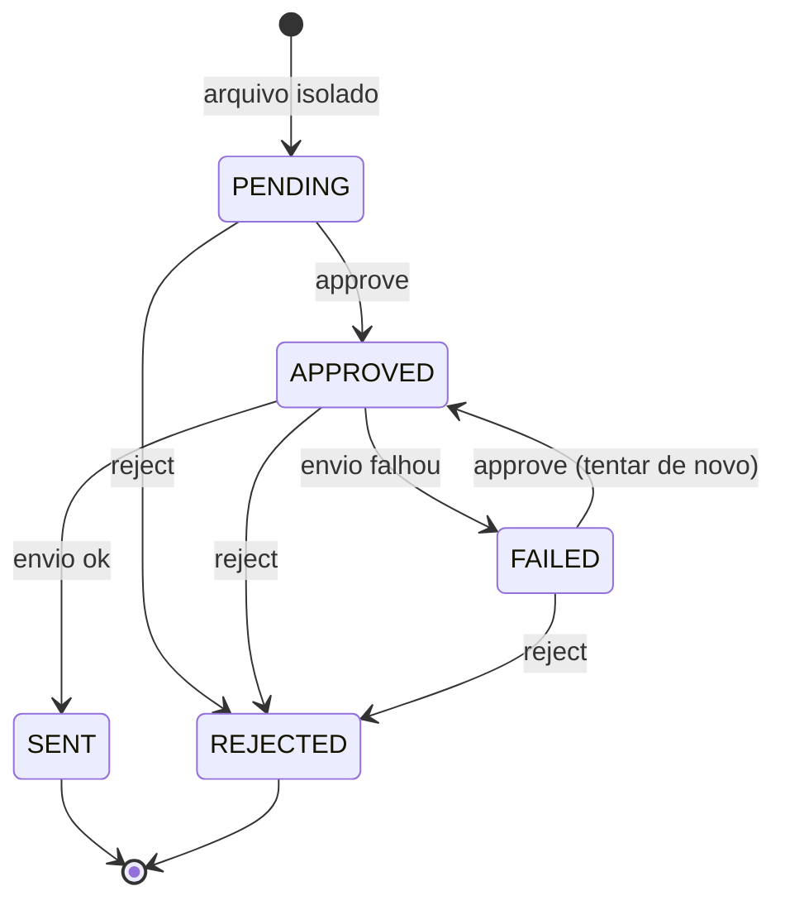
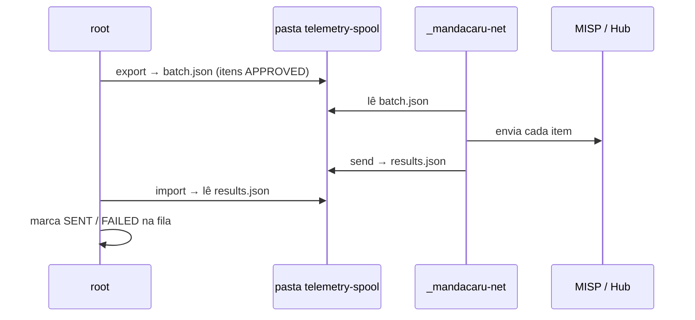

# Mandacaru 0.5 — guia das novidades

Este guia explica, sem jargão desnecessário (os termos técnicos estão explicados no [Glossário](#9-glossário), no final), o que a versão 0.5 trouxe, como usar e como as peças se encaixam.

**Em uma frase:** o Mandacaru agora **descobre quais programas instalados têm falhas de segurança conhecidas (CVEs)** e, se você quiser, **compartilha de forma anônima os malwares que encontrou** com a comunidade de segurança.

---

## Sumário

1. [Visão geral](#1-visão-geral)
2. [Auditoria de vulnerabilidades (CVEs)](#2-auditoria-de-vulnerabilidades-cves)
3. [Telemetria opt-in](#3-telemetria-opt-in)
4. [Segurança: quem faz o quê](#4-segurança-quem-faz-o-quê)
5. [Configuração](#5-configuração)
6. [Arquivos e pastas](#6-arquivos-e-pastas)
7. [Mapa do código](#7-mapa-do-código)
8. [Perguntas frequentes](#8-perguntas-frequentes)
9. [Glossário](#9-glossário)

---

## 1. Visão geral

| Funcionalidade | O que faz | Vem ligada? |
|---|---|---|
| **Auditoria de CVEs** | Todo dia, compara os pacotes instalados com bancos públicos de falhas e avisa sobre as graves | ✅ Sim |
| **Alertas de CVE** | As falhas graves novas aparecem no popup e no `alerts.jsonl`, como qualquer outro alerta | ✅ Sim |
| **Telemetria** | Guarda um resumo anônimo de cada arquivo isolado na quarentena; só envia depois que você aprova | ❌ Não (opt-in) |

Comandos novos:

```text
mandacaru vuln scan                 → procura CVEs agora
mandacaru vuln snapshot-running     → lista os pacotes em uso (usado pelo serviço)
mandacaru telemetry status          → mostra como a telemetria está configurada
mandacaru telemetry review          → mostra o que está na fila
mandacaru telemetry approve <id>    → autoriza o envio de um item
mandacaru telemetry reject <id>     → descarta um item
mandacaru telemetry flush           → envia os aprovados agora (o serviço faz isso sozinho)
```

---

## 2. Auditoria de vulnerabilidades (CVEs)

### O que é

Uma **CVE** é uma falha de segurança catalogada publicamente (ex.: `CVE-2024-4741`, no OpenSSL). O Mandacaru lê a lista de pacotes instalados no sistema e pergunta a dois serviços públicos:

- **[OSV.dev](https://osv.dev)** (Google): quais falhas afetam esta versão deste pacote?
- **CISA KEV** (governo dos EUA): dessas falhas, quais **já estão sendo exploradas por atacantes de verdade**?

> 🔒 **Privacidade:** só saem da máquina o **nome e a versão dos pacotes**. Nada de usuário, arquivos, caminhos ou nome do computador.

### Como ele decide o que é grave

Cada falha recebe uma prioridade:

| Prioridade | Quando acontece | Precisa agir? |
|---|---|---|
| 🔴 `CRITICAL_ACTIVE` | Falha grave **e** o programa está **rodando agora** | Atualize já |
| 🟠 `HIGH` | Nota CVSS ≥ 7, prioridade alta da distro, ou falha já explorada (KEV) | Atualize logo |
| 🟡 `MEDIUM` | Nota CVSS ≥ 4, prioridade média, ou aviso de segurança da distro (USN/DSA) com atualização pendente | Na próxima atualização |
| ⚪ `LOW` | O resto | Sem pressa |

**CVSS** é a nota de gravidade de 0 a 10. O Mandacaru calcula a nota a partir do vetor oficial, sem depender de bibliotecas externas. Quando a distro (ex.: Ubuntu) só informa "high/medium/low", essa informação é usada no lugar da nota.

**"Rodando agora"** quer dizer que algum processo tem aquele programa ou biblioteca carregado na memória. Exemplo: se a `libssl` está em uso por um serviço, uma falha no OpenSSL vira `CRITICAL_ACTIVE`.

### Como usar

**Automático (serviço instalado pelo `.deb`):** um timer roda o scan uma vez por dia. Você não precisa fazer nada; as falhas graves novas chegam como alerta.

**Manual, no terminal:**

```bash
# procurar agora (o cache fica na sua pasta pessoal)
mandacaru vuln scan --cache-dir ~/.cache/mandacaru

# resultado em JSON, para guardar ou processar
mandacaru vuln scan --cache-dir ~/.cache/mandacaru --json > cves.json

# forçar o serviço a rodar agora
sudo systemctl start mandacaru-vuln-scan.service

# ver o relatório da última execução do serviço
sudo cat /var/lib/mandacaru/vuln_cache/last-scan.json
```

Exemplo de saída:

```text
[HIGH           ] CVSS  9.8  openssl (3.0.13-0ubuntu3.1)  CVE-2024-4741
[HIGH           ] CVSS  9.4  openssh (1:9.6p1-3ubuntu13)  CVE-2026-60002
[MEDIUM         ] sem CVSS   openssl (3.0.13-0ubuntu3.1)  CVE-2026-35189,CVE-2026-35191
97 vulnerabilidade(s) encontrada(s).
```

**Código de saída:** `0` nada grave · `1` erro · `2` achou falha `HIGH` ou `CRITICAL_ACTIVE` (útil em scripts e CI).

### Opções do `vuln scan`

| Opção | Para que serve |
|---|---|
| `--cache-dir PASTA` | Onde guardar o cache (padrão: `/var/lib/mandacaru/vuln_cache`, só para o serviço) |
| `--json` | Imprime o resultado em JSON |
| `--report ARQUIVO` | Grava o resultado completo em JSON (substitui o arquivo) |
| `--emit-alerts` | Grava as falhas graves no arquivo de alertas |
| `--alerts-file ARQUIVO` | Para onde vai o `--emit-alerts` (padrão: `[alerts] json` do config) |
| `--no-kev` | Não consulta a lista de falhas exploradas |
| `--no-running` | Não verifica o que está rodando |
| `--running-file ARQUIVO` | Usa uma lista pronta de pacotes em uso (feita pelo `snapshot-running`) |
| `--ecosystem NOME` | Força a distro (ex.: `Ubuntu:24.04`, `Debian:12`); normalmente é detectada sozinha |
| `--status-file ARQUIVO` | Outra lista de pacotes no lugar de `/var/lib/dpkg/status` |

### Como os alertas chegam até você



Para não encher a tela:

- Cada falha é avisada **uma vez só**. Se ela sumir (você atualizou) e voltar, é avisada de novo.
- Se aparecerem **mais de 5 falhas novas de uma vez**, as 5 mais graves vêm uma a uma e o resto chega num único **alerta-resumo**.
- Reiniciar o computador ou o serviço **não** repete os avisos.

### Distros suportadas

Ubuntu, Debian e derivados: Linux Mint, Pop!_OS, elementary e LMDE. Nos derivados, o Mandacaru usa a versão do Ubuntu ou Debian em que a distro se baseia, que é o que o OSV.dev entende.

---

## 3. Telemetria opt-in

### O que é

**Telemetria** é quando um programa envia, por conta própria, informações sobre o que aconteceu no computador para um servidor externo. Muitos programas fazem isso sem perguntar. No Mandacaru é diferente: vem **desligada**, só envia **o que você aprovar** e nunca leva dados pessoais.

Na prática, funciona como **avisar os vizinhos sobre um golpe**: você não conta quem é nem onde mora, só descreve o golpista para que os outros o reconheçam.

Quando a quarentena isola um arquivo malicioso, o Mandacaru pode guardar um **resumo anônimo** dele para compartilhar com:

- um **MISP** próprio (plataforma usada por CSIRTs, como o CERT.br);
- o **Mandacaru Threat Hub** (servidor da comunidade).

Isso ajuda outras pessoas a reconhecerem o mesmo malware.

### O que vai e o que nunca vai

| ✅ Vai no resumo | ❌ Nunca vai |
|---|---|
| Hash SHA-256 do arquivo | Caminho do arquivo |
| Tamanho | Seu usuário ou nome do computador |
| Tipo (ELF, script de shell, Python...) | `machine-id` |
| Nomes das regras que detectaram | IPs da sua rede interna |
| Técnicas MITRE ATT&CK | Conteúdo de documentos pessoais |
| Distro e arquitetura (ex.: `ubuntu 24.04 x86_64`) | |

### Passo a passo

**1. Ligar** — em `/etc/mandacaru/config.toml`:

```toml
[telemetry]
level = "iocs_only"
misp_enabled = true
misp_url = "https://misp.minhaempresa.com.br"
```

A chave do MISP **não** fica no config. Ela vai num arquivo separado, legível só pelo root:

```bash
echo 'MANDACARU_MISP_API_KEY=sua-chave-aqui' | sudo tee /etc/mandacaru/secrets.env
sudo chmod 600 /etc/mandacaru/secrets.env
sudo systemctl restart mandacaru
```

**2. Revisar a fila** — cada arquivo isolado aparece como `PENDING`:

```bash
sudo mandacaru telemetry status
sudo mandacaru telemetry review          # resumo de cada item
sudo mandacaru telemetry review --json   # tudo o que seria enviado
```

**3. Decidir:**

```bash
sudo mandacaru telemetry approve 3    # autoriza
sudo mandacaru telemetry reject 4     # descarta de vez
```

**4. Enviar** — automático, de hora em hora:

```bash
sudo systemctl enable --now mandacaru-telemetry.timer
```

Ou na hora: `sudo systemctl start mandacaru-telemetry.service`. Use o serviço, e não o `telemetry flush`: só o serviço carrega a chave do `secrets.env`.

### Ciclo de vida de um item



Regras importantes:

- Um item **enviado** ou **rejeitado** nunca volta para a fila.
- Com `require_approval = false`, os itens já entram como `APPROVED` (não recomendado).
- O mesmo arquivo (mesmo hash) entra na fila uma vez só.

### Níveis

| `level` | Comportamento |
|---|---|
| `off` | Nada é guardado nem enviado (padrão) |
| `iocs_only` | Só o resumo (hash, tipo, regras...) |
| `samples_elf` | O resumo e mais a marcação de "amostra elegível" para executáveis ELF e scripts de até `max_sample_mb` |

> ℹ️ O envio do **arquivo** da amostra ainda não existe; por enquanto vai só a marcação de que ele é elegível.

---

## 4. Segurança: quem faz o quê

A regra da 0.5 é: **o que tem acesso à internet não tem privilégio, e o que tem privilégio não acessa a internet.**

O pacote cria o usuário **`_mandacaru-net`**, sem senha, sem pasta pessoal e sem nenhuma permissão especial. Só ele conversa com a internet.

| Tarefa | Quem roda | Rede? | Por quê |
|---|---|---|---|
| Ver o que está rodando (`/proc`) | root | ❌ | Só o root enxerga os processos dos outros usuários |
| Consultar OSV.dev e CISA | `_mandacaru-net` | ✅ | Se for invadido, não tem poder nenhum |
| Publicar os alertas de CVE | monitor (root) | ❌ | É ele que fala com o popup |
| Guardar a fila da telemetria | root | ❌ | A fila não pode ser alterada por quem acessa a rede |
| Enviar para MISP/Hub | `_mandacaru-net` | ✅ | Recebe só uma **cópia** dos itens aprovados |

Como root e `_mandacaru-net` trocam informação: por arquivos JSON numa pasta do usuário de rede. O root sempre:

- **escreve** criando um arquivo novo e renomeando por cima (um atalho/symlink plantado ali é substituído, nunca seguido);
- **lê** sem seguir atalhos e com limite de tamanho;
- **desconfia** do que lê: um resultado de envio forjado só consegue mexer em itens que já estavam aprovados.

Fluxo do envio da telemetria (um ciclo do timer):



---

## 5. Configuração

Arquivo: `/etc/mandacaru/config.toml`. Depois de editar: `sudo systemctl restart mandacaru`.

```toml
[vuln]
enabled = true                 # liga/desliga a auditoria de CVEs
cache_ttl_hours = 24           # por quanto tempo reaproveitar o que já foi baixado
kev_enrichment = true          # consulta a lista de falhas já exploradas (CISA KEV)
correlate_running_procs = true # destaca o que está rodando (CRITICAL_ACTIVE)
alert_min_cvss = 7.0           # nota mínima para ser HIGH

[telemetry]
level = "off"                  # off | iocs_only | samples_elf
require_approval = true        # exige approve antes de enviar
tlp = "TLP:CLEAR"              # TLP:CLEAR (público) | TLP:GREEN (comunidade)
max_sample_mb = 15             # limite para "amostra elegível"
hub_enabled = false
hub_endpoint = ""
misp_enabled = false
misp_url = ""
misp_verify_tls = true         # deixe true, a não ser em MISP de laboratório
```

Se uma chave estiver errada (nome desconhecido, tipo errado ou valor fora da lista), o Mandacaru **se recusa a iniciar** e diz qual chave é. A chave antiga `[vuln] mode` foi removida, porque não tinha efeito.

O `config.toml` fica como `root:_mandacaru-net 0640`: o usuário de rede consegue ler, e mais ninguém além do root.

---

## 6. Arquivos e pastas

| Caminho | Dono | O que é |
|---|---|---|
| `/var/lib/mandacaru/vuln_cache/osv.db` | `_mandacaru-net` | Cache dos detalhes das CVEs |
| `/var/lib/mandacaru/vuln_cache/kev.db` | `_mandacaru-net` | Cache da lista CISA KEV |
| `/var/lib/mandacaru/vuln_cache/running.json` | root (o scan só lê) | Pacotes em uso no momento do scan |
| `/var/lib/mandacaru/vuln_cache/last-scan.json` | `_mandacaru-net` | Resultado completo do último scan |
| `/var/lib/mandacaru/vuln_seen.json` | root | Falhas já avisadas (evita repetir) |
| `/var/lib/mandacaru/telemetry/outbox.db` | root | Fila da telemetria |
| `/var/lib/mandacaru/telemetry-spool/` | `_mandacaru-net` | Troca de arquivos no envio |
| `/etc/mandacaru/secrets.env` | root | Chave do MISP (você cria) |

Serviços e timers:

| Unit | Quando roda | Ligado na instalação? |
|---|---|---|
| `mandacaru-vuln-scan.timer` | 1×/dia (10 min após o boot, com atraso aleatório de até 1 h) | ✅ |
| `mandacaru-vuln-scan.service` | Disparado pelo timer | — |
| `mandacaru-telemetry.timer` | De hora em hora | ❌ (opt-in) |
| `mandacaru-telemetry.service` | Disparado pelo timer | — |

Comandos úteis:

```bash
systemctl list-timers 'mandacaru*'          # próximas execuções
journalctl -u mandacaru-vuln-scan -n 50     # log do último scan
journalctl -u mandacaru-telemetry -n 50     # log do último envio
```

---

## 7. Mapa do código

```text
src/mandacaru/
├── fsutil.py                 escrita atômica sem seguir symlink, leitura com limite
├── vuln/
│   ├── inventory.py          lê o dpkg, descobre a distro, vê o que está rodando
│   ├── osv_client.py         consulta o OSV.dev (em lote + detalhes em paralelo, com cache)
│   ├── kev_cache.py          baixa e guarda a lista CISA KEV
│   ├── scorer.py             calcula CVSS 3.1, define a prioridade, junta avisos repetidos
│   ├── publish.py            monitor: transforma o relatório em alertas novos
│   └── cli.py                comandos `vuln scan` e `vuln snapshot-running`
└── telemetry/
    ├── sanitizer.py          tira dados pessoais (usuários, senhas, IPs internos)
    ├── producer.py           monta o resumo de cada arquivo isolado
    ├── outbox.py             fila SQLite e regras de estado
    ├── mappers.py            formato MISP e MalwareBazaar
    ├── dispatcher.py         envia para MISP/Hub (remove a chave em redirecionamentos)
    ├── spool.py              troca de arquivos root ↔ _mandacaru-net
    └── cli.py                comandos `telemetry ...`
```

Funções principais, para quem vai mexer no código:

| Função / classe | Arquivo | Faz |
|---|---|---|
| `parse_dpkg_status()` | `vuln/inventory.py` | Lista os pacotes instalados, agrupados pelo pacote-fonte |
| `detect_ecosystem()` | `vuln/inventory.py` | Descobre `Ubuntu:24.04`, `Debian:12`... a partir do `/etc/os-release` |
| `find_running_packages()` | `vuln/inventory.py` | Pacotes com programa ou biblioteca carregados em algum processo |
| `OsvClient.query_packages()` | `vuln/osv_client.py` | Falhas de cada pacote, com detalhes |
| `KevCache.get_cves()` | `vuln/kev_cache.py` | Conjunto de CVEs já exploradas |
| `parse_cvss31_base_score()` | `vuln/scorer.py` | Nota CVSS 3.1 a partir do vetor |
| `classify_finding()` | `vuln/scorer.py` | Define a prioridade de uma falha |
| `drop_redundant_advisories()` | `vuln/scorer.py` | Remove avisos que só repetem CVEs já listadas |
| `run_vuln_scan()` | `vuln/cli.py` | O scan completo, do dpkg à lista ordenada |
| `VulnReportPublisher.poll()` | `vuln/publish.py` | Lê o relatório e emite só os alertas novos |
| `make_enqueuer()` | `telemetry/producer.py` | Gancho do motor: arquivo isolado → item na fila |
| `TelemetryOutbox` | `telemetry/outbox.py` | `enqueue`, `approve`, `reject`, `mark_sent`, `mark_failed` |
| `TelemetryDispatcher.send()` | `telemetry/dispatcher.py` | Envia um resumo para os destinos ligados |
| `export_batch()` / `send_batch()` / `import_results()` | `telemetry/spool.py` | As três etapas do envio separado por privilégio |

O motor ganhou um gancho opcional, `Engine(on_isolated=...)`, chamado a cada arquivo isolado. Um erro nele só gera um aviso; a detecção continua.

---

## 8. Perguntas frequentes

**O scan deixa o computador lento?**
Não. Ele roda uma vez por dia, em segundo plano. As consultas ficam em cache por 24 h, então as execuções seguintes são rápidas.

**Estou sem internet. O que acontece?**
O scan usa o que já está no cache. Uma falha de rede não cancela o resultado; só fica de fora o que nunca foi baixado, e aparece um aviso.

**Por que aparece "sem CVSS"?**
Algumas falhas só têm a classificação da distro (ex.: "medium" do Ubuntu), sem nota numérica. A prioridade vem dessa classificação.

**Recebi um alerta-resumo com "mais 39 vulnerabilidades". Onde vejo todas?**
Rode `mandacaru vuln scan --cache-dir ~/.cache/mandacaru` ou veja `/var/lib/mandacaru/vuln_cache/last-scan.json`.

**Como resolvo as falhas?**
Normalmente basta atualizar o sistema: `sudo apt update && sudo apt upgrade`. No scan seguinte, o que foi corrigido some da lista.

**A telemetria manda meus arquivos para fora?**
Não. Ela manda só o resumo (hash, tipo, regras), e só o que você aprovar. Sem `approve`, nada sai.

**Quero desligar tudo de rede.**
Em `/etc/mandacaru/config.toml`, use `[vuln] enabled = false` e mantenha `[telemetry] level = "off"`.

---

## 9. Glossário

Termos técnicos usados neste guia, em ordem alfabética.

| Termo | O que significa |
|---|---|
| **`.deb`** | Arquivo de instalação de programas no Ubuntu e no Debian, como um "instalador". |
| **Alerta** | Aviso do Mandacaru de que encontrou algo suspeito ou perigoso. |
| **`alerts.jsonl`** | Arquivo onde o Mandacaru grava todos os alertas, um por linha. Fica em `/var/log/mandacaru/`. |
| **API** | "Porta de entrada" de um serviço na internet, por onde um programa faz perguntas e recebe respostas. |
| **`apt`** | Programa do Ubuntu/Debian que instala e atualiza pacotes (`sudo apt upgrade`). |
| **Arquitetura** | Tipo de processador do computador, como `x86_64` (PCs comuns) ou `aarch64` (ARM). |
| **Atacante** | Pessoa ou programa que tenta invadir ou prejudicar um sistema. |
| **Biblioteca** | Pedaço de programa reaproveitado por vários outros. Ex.: a `libssl` faz a criptografia de muitos programas. |
| **Cache** | Cópia local de algo já baixado, para não precisar buscar de novo na internet. |
| **Chave de API** | Senha que um programa usa para se identificar num serviço (ex.: no MISP). |
| **CERT.br** | Grupo brasileiro que responde a incidentes de segurança na internet. |
| **CI** | "Integração contínua": testes automáticos que rodam a cada mudança no código. |
| **CISA** | Agência de cibersegurança do governo dos EUA. |
| **CISA KEV** | Lista da CISA com as falhas que **já estão sendo usadas em ataques reais** (*Known Exploited Vulnerabilities*). |
| **Código de saída** | Número que um comando devolve ao terminar: `0` é sucesso, outros números indicam situações específicas. |
| **Config / `config.toml`** | Arquivo de configuração do Mandacaru, em `/etc/mandacaru/config.toml`. TOML é o formato do arquivo. |
| **CSIRT** | Equipe que responde a incidentes de segurança de uma empresa, governo ou país. |
| **CVE** | Identificador público de uma falha de segurança, como `CVE-2024-4741`. Funciona como um "RG" da falha. |
| **CVSS** | Nota de 0 a 10 que mede a gravidade de uma falha. Acima de 7 é considerada alta; acima de 9, crítica. |
| **Distro** | Distribuição Linux: Ubuntu, Debian, Mint etc. |
| **Derivado** | Distro baseada em outra. O Linux Mint e o Pop!_OS são derivados do Ubuntu. |
| **`dpkg`** | Sistema que registra os pacotes instalados no Ubuntu/Debian. A lista fica em `/var/lib/dpkg/status`. |
| **DSA** | Aviso de segurança oficial do Debian (*Debian Security Advisory*). |
| **ELF** | Formato dos programas executáveis no Linux, o equivalente ao `.exe` do Windows. |
| **Hash / SHA-256** | "Impressão digital" de um arquivo: um código único calculado a partir do conteúdo. Arquivos iguais têm o mesmo hash, mas o hash não permite recriar o arquivo. |
| **IOC** | Indicador de comprometimento: pista que identifica um ataque, como o hash de um malware ou o IP de um servidor criminoso. |
| **IP** | Endereço de um computador na rede. Os IPs internos (ex.: `192.168.x.x`) são da sua casa ou empresa e nunca são enviados. |
| **JSON** | Formato de texto para guardar dados organizados, fácil de ler por programas. |
| **`journalctl`** | Comando que mostra o registro (log) dos serviços do sistema. |
| **LGPD** | Lei Geral de Proteção de Dados, a lei brasileira de privacidade. |
| **Log** | Registro do que um programa fez, linha por linha, com data e hora. |
| **Malware** | Programa malicioso: vírus, ransomware, minerador escondido etc. |
| **MalwareBazaar** | Banco público e gratuito de amostras de malware, usado por pesquisadores. |
| **MISP** | Plataforma gratuita onde equipes de segurança compartilham informações sobre ameaças. |
| **MITRE ATT&CK** | Catálogo mundial das técnicas usadas por atacantes. Cada técnica tem um código, como `T1059` (executar comandos). |
| **Monitor** | Parte do Mandacaru que fica rodando o tempo todo, vigiando arquivos e processos. |
| **Opt-in** | Algo que vem desligado e só funciona se você ligar de propósito. |
| **OSV.dev** | Banco público de falhas de segurança mantido pelo Google, que cobre os pacotes de várias distros. |
| **Pacote** | Programa instalável no Linux. Ex.: `openssh-server`. |
| **Pacote-fonte** | Código original do qual saem um ou mais pacotes. Ex.: do pacote-fonte `openssl` saem `openssl` e `libssl3`. As falhas são registradas pelo pacote-fonte. |
| **Popup** | Janelinha de aviso que aparece na tela. |
| **Privilégio** | Poder de um usuário no sistema. Quem tem muito privilégio (o root) pode mexer em tudo. |
| **Processo** | Programa em execução. |
| **`/proc`** | Pasta especial do Linux que mostra os processos em execução e o que cada um está usando. |
| **Quarentena** | Área isolada para onde o Mandacaru move arquivos perigosos, para que não possam ser executados. |
| **Root** | O administrador do Linux, com todos os privilégios. Comandos com `sudo` rodam como root. |
| **Sanitização** | Limpeza dos dados antes do envio, removendo informações pessoais. |
| **Scan** | Varredura: verificação em busca de problemas. |
| **Script** | Programa em texto, executado por um interpretador (Bash, Python...). Começa com `#!` (*shebang*). |
| **Serviço** | Programa que roda em segundo plano, controlado pelo systemd. |
| **Socket** | "Canal" de comunicação entre programas no mesmo computador. É por ele que o popup recebe os alertas. |
| **Spool** | Pasta de passagem onde arquivos ficam esperando para serem processados por outro programa. |
| **SQLite** | Banco de dados guardado em um único arquivo. A fila e os caches usam esse formato. |
| **`sudo`** | Comando que executa outro comando como root (pede a sua senha). |
| **Symlink** | Atalho: um arquivo que aponta para outro. Atacantes às vezes usam atalhos para enganar programas privilegiados, por isso o Mandacaru nunca os segue. |
| **systemd** | Sistema que liga, desliga e agenda os serviços do Linux. |
| **Telemetria** | Envio automático de informações de um programa para um servidor externo. No Mandacaru: opt-in, anônimo e com aprovação manual. |
| **Threat Hub** | Servidor da comunidade Mandacaru que recebe os resumos de malware enviados pela telemetria. |
| **Timer** | Agendamento do systemd (como um despertador) que inicia um serviço em horários definidos. |
| **TLP** | *Traffic Light Protocol*: rótulo que diz com quem uma informação pode ser compartilhada. `TLP:CLEAR` = qualquer pessoa; `TLP:GREEN` = só a comunidade de segurança. |
| **TLS** | Criptografia das conexões na internet (o "cadeado" do `https`). |
| **Unit** | Arquivo de configuração de um serviço ou timer do systemd. |
| **USN** | Aviso de segurança oficial do Ubuntu (*Ubuntu Security Notice*). |
| **Usuário de sistema** | Usuário criado para um programa, não para uma pessoa. O `_mandacaru-net` é um deles: não tem senha nem pasta pessoal. |
| **Vulnerabilidade** | Falha num programa que pode ser usada por um atacante. |
| **YARA** | Linguagem de regras usada para reconhecer malware pelo conteúdo do arquivo. |
