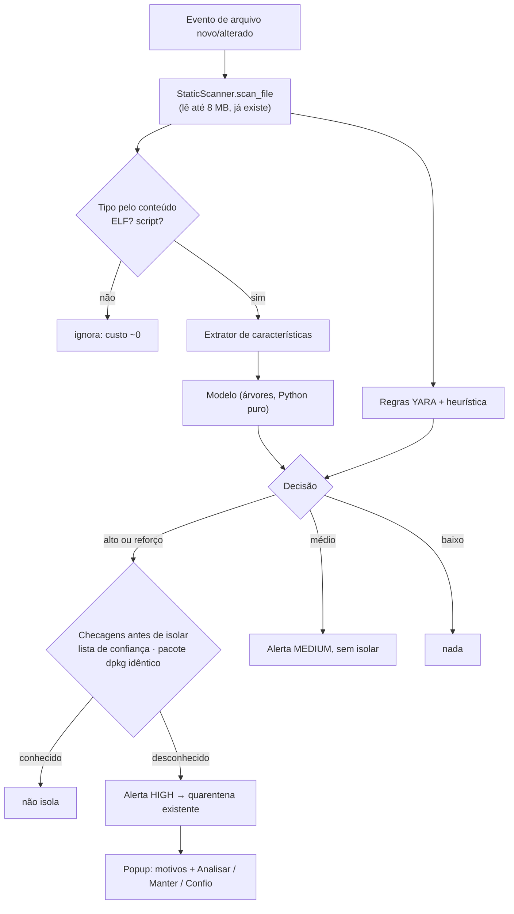

# Classificador local de malware por IA — design

Data: 2026-11-20 · Tamanho: projeto (nova frente, prevista para a v0.6.0) · Branch: `feat/classificador-ia`

Termos técnicos estão explicados no [Glossário](#20-glossário), no final.

---

## 1. Intenção

Dar ao Mandacaru um **segundo juiz** que não depende de regras escritas à mão: um modelo de IA pequeno, que roda
na própria máquina e olha cada programa e script novo nas pastas vigiadas. A tarefa dele é uma só: dizer se o arquivo
é malware. Se for, com confiança alta, o arquivo vai **na hora** para a quarentena que já existe, e o usuário pode
desfazer pelo popup.

Três custos devem ficar baixos, nesta ordem de prioridade (decisão do usuário):

1. **Isolar arquivo legítimo por engano.** Pode acontecer, mas raramente: no máximo cerca de **1 vez por mês** no uso
   normal. Quando acontecer, o usuário precisa ter como **garantir que o arquivo é seguro** antes de liberá-lo.
2. **CPU e memória:** quase zero.
3. **Dinheiro:** zero. Nada de serviço pago, nada de internet na hora de decidir.

O componente deve nascer **reutilizável**: no futuro, o usuário pensa em levá-lo a sites e sistemas, de graça ou com
custo mínimo, com a infraestrutura crescendo devagar (seção 16). Esse serviço **não** faz parte desta entrega.

## 2. O que existe hoje e a lacuna

| Peça atual | O que faz | Limite |
|---|---|---|
| 7 regras YARA (`rules/yara/base.yar`) + 1 heurística (`heur.obfuscated_script`) | Procuram textos exatos em scripts: `curl \| sh`, Python executando base64, PowerShell, shell reverso, nota de resgate, prompt injection, EICAR | **Nenhuma foi feita para ELF.** Variação de um texto escapa. Malware compactado (UPX) esconde os textos |
| 6 regras de comportamento (`detectors/behavior.py`) | Shell aberto por serviço, shell com rede, execução a partir de temporário, rajada de ransomware, agente de IA mexendo em credenciais ou abrindo shell de rede | Só **alertam**, e só **depois** que o programa já está rodando |
| Quarentena (`quarantine.py`) | Isola o arquivo quando um alerta estático tem severidade `>= HIGH` numa pasta vigiada | Depende das regras: o que elas não pegam não é isolado |
| Análise por hash (`analysis.py`) | Cymru, CIRCL, MalwareBazaar, VirusTotal | Só para arquivos já isolados, precisa de internet, só conhece o que alguém já reportou |

**Lacuna:** um programa ELF novo (minerador, botnet, backdoor) ou um script com o truque trocado chega em Downloads
ou no `/tmp` e passa sem ser isolado. Isso pesa mais com malware gerado por IA, que tende a variar a cada cópia, e
esse é justamente o foco do Mandacaru.

## 3. Objetivos, não-objetivos e anti-objetivos

**Objetivos**

- Classificar binários **ELF** e **scripts** (shell, Python, Perl, JavaScript/Node, PHP) que surgirem nas pastas
  vigiadas, **antes** da execução.
- **Isolar na hora** quando a confiança for alta; com confiança média, só alertar; com confiança baixa, nada.
- Reforçar alertas fracos das regras: regra `MEDIUM` mais modelo concordando leva ao isolamento.
- Explicar cada decisão em português ("compactado, sem símbolos, contém endereço de pool de mineração").
- Metas medidas antes de ligar o isolamento (o "portão", seção 10.4):
  - falso positivo **≤ 1 a cada 2.000** arquivos legítimos (≤ 0,05 %);
  - detecção **≥ 8 a cada 10** malwares que as regras atuais deixam passar;
  - no SUPRA (i5-9300H): mediana ≤ 30 ms e p99 ≤ 150 ms por arquivo; memória extra ≤ 15 MB.
- Zero dependências novas em tempo de execução (só biblioteca padrão do Python), mantendo o `.deb` simples.
- Treino **seguro**: nenhuma amostra executada, extraída para o disco ou publicada.
- Núcleo reutilizável: `bytes → veredito`, sem E/S, determinístico e versionado.

**Não-objetivos (desta entrega)**

- Explicador com modelo de linguagem local (Qwen/DeepSeek): fica para uma fase futura e opcional (seção 15, F7).
- Rede neural sobre bytes brutos.
- Arquivos do Windows (PE), documentos (PDF, Office), imagens.
- Serviço público de análise (site, API, upload).
- Arquivos maiores que 8 MB (limite de leitura atual do scanner): continuam só com regras e comportamento.

**Anti-objetivos (fracasso, mesmo funcionando)**

- O modelo **liberar** ou **rebaixar** qualquer coisa. Ele só **acrescenta** suspeita; nunca anula uma regra, nunca
  põe nada na lista de confiança e nunca tira um arquivo da quarentena.
- Qualquer byte de malware entrar no repositório, no pacote ou no modelo publicado.
- Isolar sem explicar por quê.
- Um arquivo hostil travar o monitor ou explorar o extrator (o monitor roda como root).
- O arquivo do modelo virar porta de entrada: nada de `pickle`, `joblib` ou formato que execute código ao carregar.
- Mandar conteúdo de arquivo do usuário para fora da máquina.

## 4. Restrições

- **Tempo de execução:** Python ≥ 3.10, só biblioteca padrão. Dependências de treino (scikit-learn ou LightGBM,
  `pyzipper`) ficam num ambiente separado e **nunca** entram no `.deb` nem no `[project.dependencies]`.
- **Onde roda:** dentro do `mandacaru.service` (root), na thread do motor. Tudo precisa ser limitado em tempo e
  memória e robusto contra entrada hostil.
- **Integração existente:** `Engine.process` → `StaticScanner.scan_file` (lê até `MAX_BYTES` = 8 MB) →
  `scan_bytes(path, data)` → `Engine._quarantine` (isola alertas `>= quarantine_min_severity`, padrão `HIGH`) →
  `Quarantine.isolate` (respeita a `TrustList`) → gancho `on_isolated` (telemetria v0.5).
- **Pastas vigiadas por padrão:** Downloads, Documentos e Desktop de cada usuário, `/tmp` e `/dev/shm`.
- **Privacidade (LGPD):** decisão 100 % local. Consultas online só quando o usuário clica em "Analisar" (como hoje).
- **Código aberto (GPLv3):** o modelo será público; segurança não pode depender de segredo (seção 17).

## 5. Abordagens consideradas

| | Abordagem | Custo no SUPRA | Prós | Contras | Resultado |
|---|---|---|---|---|---|
| **A** | Árvores de decisão (gradient boosting) sobre ~150 características extraídas do arquivo | ~23 ms/arquivo, ~10 MB RAM, R$ 0 | Barato, explicável, não "lê" frases (não cai em prompt injection), Python puro | Só vê o que as características descrevem | **Escolhida** |
| B | Rede neural sobre os bytes brutos | 50–200 ms/arquivo, onnxruntime/PyTorch (centenas de MB, fora dos repositórios do Ubuntu) | Aprende padrões não descritos | Pesada, opaca, precisa de muito mais dados | Descartada por agora |
| C | Modelo de linguagem local (Qwen, DeepSeek, Foundation-sec-8B) lendo o arquivo | 5–6 GB de RAM, segundos por arquivo | Entende a intenção de scripts | Caro para "todo arquivo", lê binário mal, sem medição confiável para ELF, **pode ser enganado por texto embutido no malware** | Talvez como explicador opcional (F7), nunca como juiz |
| D | Similaridade de hash (TLSH) com famílias conhecidas | Barato | Pega variantes próximas | Não pega o que é novo; YARA já cobre conhecidos | Descartada |
| — | API paga (ex.: DeepSeek na nuvem) | Dinheiro + rede | — | Custo, envia arquivos para fora (LGPD) | Descartada |

**Por que A:** é a única que cumpre as três prioridades ao mesmo tempo. Também é a mais segura contra o atacante que
mira o juiz: não há texto que "convença" uma árvore de decisão.

## 6. Modelo de ameaças

| Ativo | Ameaça | Exemplo | Mitigação (seção) |
|---|---|---|---|
| Arquivos do usuário | Falso positivo isola algo necessário | Binário Go do próprio usuário em `/tmp` | Portão de FP, modo sombra, checagens antes de isolar, limiar próprio do `/tmp`, "Confio" (7.4, 10.4, 15) |
| Integridade da máquina | Malware escapa (falso negativo) | Variante nova, compactada | Modelo soma às regras e ao comportamental; retreino (7.4, 10.6) |
| Monitor (root) | Arquivo hostil causa travamento ou exploração do extrator | ELF com cabeçalhos corrompidos, contagens gigantes, regex patológica | Parser Python puro com limites, sem recursão, orçamento de tempo, sem ferramentas externas (11) |
| Decisão do modelo | Troca ou adulteração do arquivo do modelo | Modelo que aprova tudo | JSON validado por esquema, hash fixado, arquivos de root, falha fechada (9, 11) |
| Decisão do modelo | Evasão adversarial (o modelo é público) | Malware ajustado para parecer comum | Regras e comportamental continuam; retreino; sem confiar em segredo (17) |
| Qualidade do modelo | Envenenamento dos dados de treino | Uploads forjados no MalwareBazaar para causar FP em software legítimo | Limite por família e por remetente, remoção de hashes sabidamente legítimos, corte temporal, revisão de deriva (10.3) |
| Máquina do desenvolvedor | Infecção durante o treino | Amostra executada sem querer, `ldd` em amostra | Ambiente isolado, amostras nunca saem do zip, testes de política (10.1, 10.2) |
| Reputação e conta do GitHub | Amostra publicada no repositório público | `git add` acidental | Corpus fora do repositório, teste que barra ELF/zip, modelo só com números (10.2, 14) |
| Privacidade | Conteúdo do usuário vazando | Explicação contendo trechos do arquivo | Motivos genéricos no `summary`; nada sai da máquina (12) |

## 7. Arquitetura

### 7.1 Visão geral



### 7.2 Módulos novos

```text
src/mandacaru/ml/
├── __init__.py        API pública: Classifier, Verdict, load_default()
├── kind.py            tipo pelo conteúdo: elf | sh | python | perl | js | php | None
├── features.py        extração determinística e limitada; FEATURE_VERSION; FEATURE_NAMES
├── model.py           carregador estrito do JSON + avaliação das árvores (iterativa) + calibração
├── explain.py         contribuição por característica (método do caminho) → motivos em português
├── reasons.py         dicionário característica → frase em português + técnica MITRE
├── knowngood.py       índice local dos md5 do dpkg (/var/lib/dpkg/info/*.md5sums), preguiçoso
├── decision.py        faixas, reforço, limiar do /tmp, modos (off/shadow/alert/isolate)
├── cli.py             `mandacaru ml status | avaliar | sombra`
└── models/
    ├── elf.json       modelo ELF (≤ 3 MB)
    ├── script.json    modelo de scripts (≤ 3 MB)
    └── golden.json    vetores de referência exportados pelo treino (só números)

tools/treino/          pipeline de treino (fora do pacote, nunca no .deb/wheel)
├── README.md          passo a passo do ambiente isolado
├── requirements.txt   dependências de treino fixadas com hash (pip --require-hashes)
├── baixar.py          MalwareBazaar → corpus/ (zips com senha, nunca extraídos)
├── benignos.py        coleta de legítimos (pacotes .deb, PyPI/npm populares, duros)
├── extrair.py         zip → bytes em memória → features.py → tabela de números
├── treinar.py         treino, calibração, escolha de limiares
├── avaliar.py         métricas, portão, relatório; grava gate_passed no modelo
└── exportar.py        modelo → JSON estrito + golden.json
```

O **mesmo** `features.py` do pacote é usado no treino. Há uma só fonte da verdade, então o que é medido no treino é
exatamente o que roda na máquina do usuário. O commit do `features.py` usado fica gravado no modelo
(`feature_code_sha`).

### 7.3 Integração com o motor e a quarentena

- **Carga:** o `StaticScanner` recebe a configuração `[ml]` e carrega o classificador uma vez, no `__init__`
  (`ml.load_default(mode)`). Sem os arquivos de modelo (ex.: instalação incompleta), o classificador fica desligado
  com um aviso, e o resto funciona.
- **Ponto de entrada:** `StaticScanner.scan_bytes(path, data)`. Depois das regras, chama o classificador com os
  **mesmos bytes** (sem leitura extra) e recebe a lista de alertas das regras para decidir o reforço.
- **Só arquivo inteiro:** o modelo só avalia se o arquivo foi lido por completo (`len(data) < MAX_BYTES`). Arquivos
  maiores ficam fora (lacuna documentada).
- **Ignorados de cara:** arquivos que não são ELF nem script; ELF do tipo `REL` (objetos `.o`, que não executam) e
  `CORE` (dumps).
- **Cache por conteúdo:** pontuação guardada por SHA-256 (LRU de 4.096 entradas). O mesmo arquivo copiado várias
  vezes, ou reescrito sem mudar, não é recalculado.
- **Isolamento:** reaproveita o caminho atual. O alerta do modelo com faixa `alto` ou `reforco` sai com severidade
  `HIGH`, e `Engine._quarantine` isola como faz com as regras.
- **Invariante explícita no motor:** um alerta `ml.*` só conta para isolamento se `evidence["ml_isolate"] is True`.
  Quem calcula esse campo é `decision.py`, que junta faixa (`alto`/`reforco`), modo (`isolate`), portão do tipo e a
  checagem do dpkg. Assim:
  - se o usuário baixar o `quarantine.min_severity` para `MEDIUM`, a faixa `medio` continua sem isolar, porque o
    orçamento de falso positivo foi calibrado só para as faixas que isolam;
  - no modo `alert`, nem a faixa `alto` isola.
- **Lista de confiança fora do modo `isolate`:** no modo `alert`, o motor rebaixa para `INFO` os alertas `ml.*` de
  hashes da lista de confiança, como já faz com as regras. Para isso o scanner grava `evidence["sha256"]`, que é a
  mesma chave do cache.
- **Nunca rebaixa:** nota baixa do modelo não altera nem suprime alertas das regras.
- **Telemetria (v0.5):** casos isolados pelo modelo entram na fila como os demais. O payload ganha
  `detection.ml = {model_id, score}` (só números).
- **Varredura avulsa (`mandacaru scan`):** mostra os alertas `ml.*` também (sem isolar, como hoje).

### 7.4 Decisão

Cada modelo traz no próprio JSON os limiares calibrados no treino, por tipo de arquivo:

| Faixa | Condição | Resultado |
|---|---|---|
| `alto` | nota ≥ `alto` (ou ≥ `alto_tmp` se o arquivo estiver em `/tmp`) | Alerta `ml.malware`, `HIGH` → **isola** |
| `reforco` | alguma regra deu `MEDIUM` ou mais **e** nota ≥ `reforco` (< `alto`) | Alerta `ml.malware_reforco`, `HIGH` → **isola** |
| `medio` | nota ≥ `medio` | Alerta `ml.suspeito`, `MEDIUM`, **não isola** |
| `baixo` | abaixo de `medio` | nada |

- **Limiar do `/tmp`:** calibrado com um conjunto de legítimos parecidos com o que cai lá (artefatos de build,
  temporários do `pip`, instaladores). `/dev/shm` usa o limiar geral, porque executável legítimo lá é raro e malware
  adora essa pasta.
- **Checagens antes de isolar** (só para decisões do modelo; as das regras seguem como hoje):
  1. **Lista de confiança:** já é feita por `Quarantine.isolate` (devolve `confiavel`).
  2. **Arquivo idêntico a um de pacote instalado:** o md5 do conteúdo está no índice do dpkg (65 mil entradas no
     SUPRA). Nesse caso, não isola e não alerta. O md5 basta aqui, porque forjar um arquivo com o mesmo md5 de um
     arquivo existente do Debian (segunda pré-imagem) não é viável.
- **Por tipo:** cada tipo (`elf`, `sh`, `python`, `perl`, `js`, `php`) tem seu próprio resultado de portão. Um tipo
  que não passou nunca isola: fica em `alert` ou `off`.

### 7.5 Alertas e popup

O cliente de popup fica fora deste repositório: ele mostra o `summary` do alerta (contrato `v: 1` do socket, sem
`evidence`), e os botões já existentes chamam os auxiliares em `/usr/libexec/mandacaru/`. Por isso o `summary` é
**uma linha de até 200 caracteres** que deixa claro que a decisão veio da IA, traz os motivos (sem conteúdo do
arquivo) e termina com a dica "use Analisar antes de Confio". O esboço abaixo mostra como o popup a exibiria:

```text
⚠ IA: dropper parece malware (confiança 93%) — compactado · sem símbolos · contém endereço de pool de mineração
  Nenhuma regra conhecida pegou este arquivo. Se você o reconhece, use Analisar antes de Confio.
  [ Analisar ]   [ Manter isolado ]   [ Confio ]
```

- **Analisar** (já existe): consulta o hash no CIRCL, que conhece milhões de arquivos sabidamente legítimos. Quando
  o CIRCL reconhece o arquivo, o veredito já é `legitimo_conhecido` ("Legítimo conhecido: CIRCL reconhece este
  arquivo"). Essa é a **garantia** que o usuário pediu antes do "Confio". Só o hash sai, e só no clique.
- **Confio:** continua pedindo senha de administrador (polkit). O hash vai para a lista de confiança e não é mais
  julgado.
- **`evidence` (só no `alerts.jsonl`, legível por root):** `path`, `score`, `ml_band`, `kind`, `model_id`,
  `feature_version` e os 5 principais motivos (`feature`, `valor`, `contribuição`).
- **MITRE:** derivado dos motivos (mineração → T1496, cron/systemd → T1053/T1543, ofuscação/compactação → T1027,
  download → T1105, shell reverso → T1059).
- **Log de decisões:** o `decisions.jsonl` já registra regra e resumo. Com `rule = ml.*`, fica auditável quantos
  "Confio" vieram de decisões do modelo.

### 7.6 Configuração

```toml
[ml]
enabled = true
mode = "shadow"   # off | shadow | alert | isolate
```

| Modo | Calcula nota | Alerta | Isola | Uso |
|---|---|---|---|---|
| `off` | não | não | não | desligar |
| `shadow` | sim | não | não | o monitor grava o que **faria** em `/var/log/mandacaru/ml-shadow.jsonl` (root, `0640`); no `mandacaru scan` avulso, `shadow` se comporta como `off` |
| `alert` | sim | sim | não | usuário cauteloso |
| `isolate` | sim | sim | sim, só nos tipos aprovados | operação normal |

- **Limiares não são configuráveis:** vêm do modelo, calibrados. A configuração só pode deixar o comportamento mais
  conservador (por modo).
- **`isolate` respeita o portão:** com `gate_passed = false` no modelo (ou no tipo), o modo `isolate` age como `alert`
  e avisa em stderr. O portão é imposto pelo próprio arquivo do modelo, não pela memória de alguém.
- Chave desconhecida ou valor inválido continua sendo erro de configuração, saída `1` (padrão do projeto).
- O `ml-shadow.jsonl` entra no `logrotate` existente.
- **De onde vem o padrão:** o `packaging/config.toml` traz a seção `[ml]` com o `mode` **comentado**, e o padrão
  vem do código. Assim, na fase F6, a troca de `shadow` para `isolate` chega a quem já instalou, mesmo com o config
  modificado (o `dpkg` preservaria um valor escrito no arquivo).

### 7.7 Linha de comando

```text
mandacaru ml status                 modelo, versão, métricas do portão, modo, tipos aprovados
mandacaru ml avaliar ARQUIVO...     nota, faixa e motivos de qualquer arquivo (não isola)
mandacaru ml sombra [--desde DATA]  resumo do modo sombra: quantos seriam isolados e por quê
```

O `ml avaliar` usa o mesmo núcleo. Serve ao usuário para conferir um arquivo e servirá de base para o uso em outros
sistemas (seção 16).

## 8. Características

Todas vêm **só do conteúdo**: nunca do nome do arquivo nem do caminho. No MalwareBazaar o nome costuma ser o próprio
hash, e usar nome ou caminho criaria diferença entre treino e uso real. Cada característica é limitada em custo.

**ELF** (parser próprio em Python, com verificação de limites em toda leitura de cabeçalho):

- estrutura: classe 32/64, endianness, `e_type` (`EXEC`/`DYN`), arquitetura (x86-64, ARM, MIPS: botnets de IoT),
  número de seções e de segmentos, ausência de tabela de seções, `PT_INTERP` (dinâmico ou estático), segmento
  gravável e executável, ponto de entrada fora de `.text` ou na última seção, sobra de dados após a última seção;
- compactação e ofuscação: entropia geral e da maior seção (amostragem de até 512 KB no total), marcadores do UPX
  (`UPX!`, seções `UPX0`/`UPX1`), nomes de seção anômalos;
- símbolos: presença de `.symtab` (sem símbolos), número de importações em `.dynsym`, importações de interesse
  (`socket`, `connect`, `execve`, `fork`, `ptrace`, `setuid`, `prctl`, `unlink`, `chmod`, `kill`...);
- textos (só strings imprimíveis do primeiro 1 MB): contagem e tamanho médio; famílias de indicadores, como
  mineração (`stratum+tcp`, `xmrig`, pools), persistência (`crontab`, unidades systemd, `rc.local`, `.bashrc`,
  `authorized_keys`), credenciais (`/etc/shadow`, `id_rsa`), antianálise (`TracerPid`, `LD_PRELOAD`), rede (IPs
  literais **dentro das strings**, portas, `User-Agent`), comandos (`wget`, `curl`, `chmod +x`, `busybox`, `tftp`,
  `/bin/sh -c`), sabotagem (`iptables -F`, `setenforce 0`, `pkill`), autoapagamento (`/proc/self/exe` + `unlink`),
  pastas escondidas (`/tmp/.`, `/dev/shm/.`).

**Scripts** (tipo pelo shebang; sem shebang, por uma heurística de conteúdo compartilhada entre treino e uso):

- tipo, tamanho, linhas, maior linha, entropia, proporção de caracteres não alfanuméricos;
- blocos longos de base64 ou hex (quantidade e maior tamanho), sequências `\x..`, vetores de códigos de caractere;
- execução dinâmica (`eval`, `exec`, `compile`, `Function(`, `source <(`), decodificação (`base64 -d`,
  `b64decode`, `atob`, `fromCharCode`, `zlib`, `marshal`);
- baixar e executar (`curl`/`wget`/`urllib`/`requests`/`fetch` combinados com `sh`/`exec`/`chmod +x`);
- persistência, credenciais, rede, sabotagem e esconderijo (as mesmas famílias do ELF, mais `nohup`, `setsid`,
  `disown`, `HISTFILE=/dev/null`, `>/dev/null 2>&1 &`);
- shell reverso; instruções de prompt injection (ataque a agentes de IA, foco do projeto).

**Limites de custo:** histograma de bytes nos primeiros 64 KB; strings no primeiro 1 MB; IPs procurados só dentro das
strings; no máximo 4.096 seções, 50.000 símbolos e 200.000 strings examinadas; regex só de forma linear (literais,
classes com quantificador simples, sem quantificadores aninhados).

## 9. Modelo e formato do arquivo

- **Algoritmo:** gradient boosting de árvores (LightGBM ou `HistGradientBoostingClassifier`; a escolha fica para quem
  construir). Até 300 árvores de profundidade ≤ 8, com um modelo para ELF e outro para scripts. A nota bruta passa por
  uma sigmoide e depois por uma calibração isotônica (tabela linear por partes) que a transforma em probabilidade.
- **Formato:** JSON estrito, avaliado em Python puro. **Proibido** `pickle`, `joblib`, ONNX ou qualquer formato que
  execute código ao carregar.

```json
{
  "format_version": 1,
  "model_id": "elf-2026.12.0",
  "created_at": "2026-12-01T00:00:00Z",
  "feature_version": 1,
  "feature_code_sha": "<commit do features.py>",
  "feature_names": ["size_log", "entropy", "..."],
  "kinds": {"elf": {"gate_passed": true, "thresholds": {"alto": 0.97, "alto_tmp": 0.99, "reforco": 0.80, "medio": 0.60}}},
  "trees": [{"feature": [3, -1, -1], "threshold": [5.2, 0, 0], "left": [1, -1, -1], "right": [2, -1, -1],
             "value": [0.0, -0.4, 1.1]}],
  "base_score": -2.1,
  "calibration": {"x": [0.0, 0.5, 1.0], "y": [0.0, 0.4, 1.0]},
  "metrics": {"fp_rate": 0.0003, "detection_rule_missed": 0.86, "benign_test_n": 8000, "malware_test_n": 5000},
  "data_manifest_sha256": "<hash do manifesto de hashes das amostras>"
}
```

- **Carregador estrito:** tamanho ≤ 10 MB; só chaves conhecidas; tipos conferidos; números finitos; índices de
  característica `< len(feature_names)`; filhos com índice **maior** que o pai (garante que a avaliação termina);
  profundidade ≤ 16; `feature_names` idêntico a `features.FEATURE_NAMES` e `feature_version` igual. Qualquer falha
  **desliga só o classificador** e gera um alerta `ml.modelo_invalido` (`HIGH`). Regras e comportamental seguem
  funcionando.
- **Hash fixado:** o SHA-256 de cada JSON fica numa constante em `ml/__init__.py`, gerada na release. Isso protege
  contra corrupção e atualização parcial. Contra quem já é root, nada protege (aí o sistema já está comprometido), e o
  documento diz isso com franqueza.
- **Explicação:** contribuição por característica pelo método do caminho (soma das mudanças de valor ao longo do
  caminho percorrido em cada árvore). Para isso, o exportador grava o valor dos nós internos (campo `value`). As 3
  maiores contribuições positivas viram os motivos do popup (via `reasons.py`).
- **Determinismo:** os mesmos bytes sempre dão a mesma nota. O `golden.json` (vetores de características e notas
  esperadas, calculados pela biblioteca de treino) garante que o avaliador em Python puro reproduz o treino com
  tolerância de 1e-9.

## 10. Pipeline de treino reforçado

### 10.1 Ambiente isolado

Ordem de preferência, sem custo:

1. **Container Docker sem rede** na extração e no treino:
   `--network none --read-only --cap-drop ALL --security-opt no-new-privileges --user 1000`, corpus montado só para
   leitura, saída numa pasta própria. Hoje o Docker Desktop do SUPRA não abre por causa de um
   `%LOCALAPPDATA%\docker-secrets-engine\engine.sock` velho, que o usuário precisa apagar.
2. **Distro WSL `UbuntuPentest` endurecida** (alternativa):
   - `/etc/wsl.conf` com `[automount] enabled = false`, `mountFsTab = false` e
     `[interop] enabled = false`, `appendWindowsPath = false`; depois `wsl --terminate UbuntuPentest`;
   - usuário dedicado `treino`, **sem sudo**; corpus em `/home/treino/corpus` (`0700`);
   - verificação registrada antes de cada sessão: `/mnt/c` vazio, `cmd.exe` indisponível, `sudo -n true` falhando.
   - Ressalva honesta: as distros WSL2 compartilham o mesmo kernel; isso é um cômodo separado, não outra casa. Como
     nada é executado, é suficiente.
3. **Nunca na `Ubuntu-Dev`:** ali estão o token do `gh`, as chaves e o repositório com permissão de push.

Rede só na etapa de download. Em rede de empresa, baixar malware pode disparar alertas da equipe de segurança local.

### 10.2 Regras de ouro do manuseio

1. **Nenhuma amostra é executada.** O código de `tools/treino/` não importa `subprocess`, `pty` ou `ctypes` e não
   chama `os.system`, `os.popen`, `os.exec*` ou `os.spawn*`. Um teste de política (análise da AST) barra isso no CI.
2. **Nenhuma amostra sai do zip.** O zip com senha é lido direto na memória (`zipfile` ou `pyzipper`, conforme a
   criptografia). Proibidos `extractall`, `shutil.unpack_archive` e escrever bytes de amostra em disco (o teste de
   política também barra). Nunca `chmod +x`.
3. **Nenhuma ferramenta externa toca nas amostras:** nada de `file`, `readelf`, `objdump`, `strings`, `yara` (CLI) ou
   **`ldd`**, que pode executar o programa. O extrator é Python puro. Para medir "o que as regras deixam passar", o
   `yara-python` roda só dentro do container sem rede.
4. **Limites:** amostra ≤ 8 MB lida (o mesmo limite do produto); corpus com orçamento de disco definido.
5. **Corpus fora de qualquer repositório git**, fora das pastas vigiadas pelo Mandacaru e fora de `/mnt`.
6. **Só saem do ambiente de treino:** o JSON do modelo, o `golden.json`, o relatório de métricas (Markdown) e o
   manifesto de hashes. Todos são texto e passam por validação de esquema ao chegar na `Ubuntu-Dev`. A cópia é
   unidirecional: a `Ubuntu-Dev` lê com `wsl.exe -d UbuntuPentest -u treino cat ...`, e a `UbuntuPentest` não enxerga
   nada da `Ubuntu-Dev`.
7. **Logs de treino nunca contêm bytes de amostra**, só hashes e números.
8. **Dependências de treino fixadas com hash** (`pip install --require-hashes -r requirements.txt`), num ambiente
   virtual próprio.

### 10.3 Fontes de dados e higiene

- **Malicioso:** MalwareBazaar (abuse.ch), com chave de API gratuita. Tipos ELF e scripts (`sh`, `py`, `pl`, `js`,
  `php`). Os termos de uso das fontes precisam ser conferidos antes da coleta.
- **Legítimo:**
  - binários e scripts de pacotes `.deb` populares do Ubuntu e do Debian (`main` e `universe`; abrir um `.deb`
    legítimo é seguro);
  - scripts de pacotes populares e antigos do PyPI e do npm (versões fixadas), já que o npm e o PyPI também têm
    pacotes maliciosos;
  - **legítimos difíceis**, de propósito: binários Go e Rust estáticos (grandes, sem símbolos), ferramentas
    legítimas compactadas com UPX, AppImages, instaladores `.run`, instaladores no estilo `curl | sh` (rustup, nvm),
    artefatos de build e temporários do `pip`.
- **Higiene:**
  - deduplicação por SHA-256;
  - remoção de qualquer hash presente nos dois lados;
  - remoção do lado malicioso de todo hash que o CIRCL reconhece como legítimo (só hashes de amostras saem, sem
    problema de privacidade);
  - limite de amostras por família (tag `signature`) e por remetente, contra envenenamento e contra uma família
    dominar o modelo.
- **Divisão:** corte **temporal** (treina com o que apareceu antes da data X e testa com o que veio depois, que
  simula "malware novo"). Também há um corte **por família** (famílias inteiras ficam só no teste), que mede a
  generalização. Os conjuntos de calibração e de teste são separados.
- **Tamanho-alvo** (ajustável): 10 a 30 mil ELF maliciosos e alguns milhares de scripts; 50 mil ou mais legítimos.
  **Pelo menos 6.000 legítimos no teste final**: para afirmar FP ≤ 0,05 % com 95 % de confiança com zero erros,
  pela regra dos três (3/N), são precisos N ≥ 6.000.

### 10.4 Avaliação e portão de qualidade

Medido por tipo de arquivo, e registrado no relatório e no JSON do modelo:

| Métrica | Meta para liberar o isolamento |
|---|---|
| Falso positivo no teste legítimo geral | ≤ 0,05 % (≤ 1 em 2.000), com N ≥ 6.000 |
| Falso positivo nos legítimos difíceis | relatado por categoria; nenhuma categoria acima de 0,5 % |
| Falso positivo nos arquivos **do próprio usuário** (ver abaixo) | zero isolamentos indevidos ou cada caso explicado |
| Detecção nos malwares que as 7 regras atuais deixam passar | ≥ 80 % |
| Detecção geral no teste temporal | relatada (sem meta mínima) |
| Latência no SUPRA | mediana ≤ 30 ms; p99 ≤ 150 ms |
| Tamanho do modelo | ≤ 3 MB por JSON |

- **Arquivos do próprio usuário:** com o modelo **final** (sem nenhuma amostra de malware), o `mandacaru ml avaliar`
  roda na `Ubuntu-Dev` sobre `/usr/bin`, `~/.local`, os projetos do usuário e o histórico de Downloads. Nada sai da
  máquina e nada é commitado.
- **Escolha dos limiares:** no conjunto de calibração, para caber no orçamento de FP, e conferida no teste.
- **Reforço:** calibrado só com os legítimos em que alguma regra disparou (`MEDIUM` ou mais), por exemplo
  instaladores `curl | sh`. Se houver menos de 300 desses exemplos, `reforco = alto` (o reforço fica sem efeito)
  em vez de um limiar mal medido.
- **Mínimo por tipo:** um tipo só pode passar no portão com pelo menos 500 maliciosos e 6.000 legítimos no teste.
  Com menos dados (provável para `perl`, `php` e `js` no começo), o tipo fica em `alert`.
- **Regressão:** um modelo novo não pode ter FP maior que o anterior nos legítimos do conjunto anterior.
- **Resultado gravado no JSON** (`gate_passed` por tipo). Um tipo reprovado vai para o pacote, mas nunca isola.

### 10.5 Publicação

- O JSON do modelo e o `golden.json` entram em `src/mandacaru/ml/models/` (package data no `pyproject.toml`, que
  vai no wheel e no `.deb`).
- Junto vai o relatório `docs/ml/relatorio-<model_id>.md`, com as métricas e o manifesto de hashes. Nunca vão
  amostras.
- O modelo é atualizado junto com as releases do pacote (o canal de atualização é o do `apt`/`pip`). Se um dia o
  modelo for distribuído separado do pacote, a assinatura (Ed25519/minisign) passa a ser obrigatória (seção 16).

### 10.6 Retreino

- A cada release, ou a cada trimestre, com o corte temporal avançando.
- Os falsos positivos reportados pelo usuário (casos de "Confio" em decisões `ml.*`, revisados por ele) entram como
  legítimos difíceis, localmente. O conteúdo não é publicado; só o fato de que aquela categoria precisa de mais
  exemplos.
- O modelo anterior fica guardado para reverter.

## 11. Segurança em tempo de execução

- **Entrada hostil:** toda leitura de estrutura usa `struct.unpack_from` com verificação de limites; deslocamentos e
  contagens do arquivo nunca são confiados; laços com teto; nada de recursão; regex só de forma linear; teste de
  robustez com entradas aleatórias e malformadas (seção 14).
- **Orçamento por arquivo:** as janelas fixas de leitura (seção 8) limitam o pior caso. O tempo é conferido entre as
  etapas da extração (não dá para interromper código Python no meio de uma etapa, por isso as janelas fixas são a
  garantia real). Se passar de 250 ms, o resultado é descartado, o modelo não opina sobre aquele arquivo e fica um
  aviso em stderr. O monitor não trava esperando.
- **Sem ferramentas externas, sem processos filhos, sem rede** no classificador.
- **Falha fechada para o modelo e aberta para o resto:** erro no modelo nunca isola nem libera nada; regras,
  comportamental e quarentena seguem iguais.
- **Modelo como alvo:** JSON estrito, hash fixado, arquivos de root `0644` em `dist-packages`. Adulteração detectada
  vira o alerta `ml.modelo_invalido`.
- **O modelo nunca libera nada:** a lista de confiança continua a única forma de "permitir", e exige senha de
  administrador.
- **Fadiga de alerta:** FP raro, motivos claros e "Analisar" com resposta de "Legítimo conhecido" reduzem o risco de o
  usuário clicar em "Confio" por hábito.

## 12. Privacidade

- A decisão é 100 % local; nada sai da máquina para decidir.
- `summary` (o que vai ao socket e ao popup): nome do arquivo (como já acontece nas regras) e motivos genéricos, sem
  trechos do conteúdo (IPs, URLs e comandos encontrados ficam só no `evidence`, legível por root).
- O modo sombra grava caminhos no `ml-shadow.jsonl` (root, `0640`), com o propósito de revisar falsos positivos na
  própria máquina.
- A telemetria (opt-in, v0.5) ganha só `{model_id, score}`.

## 13. Custos

Medidos no SUPRA (i5-9300H, 8 núcleos, 11 GB) com 600 programas reais do sistema (média de 237 KB) num protótipo
descartável:

| Item | Custo |
|---|---|
| Por programa ou script analisado | ~23 ms (extração ~22 ms + modelo ~1 ms) |
| Arquivo que não é programa nem script | ~0 (descartado pelos primeiros bytes) |
| Dia normal (dezenas de arquivos novos) | menos de 1 s de CPU por dia |
| Pior caso (extrair 2.000 programas de uma vez) | ~45 s de um núcleo, em segundo plano |
| Memória | ~10 MB (modelo) + ~3–5 MB (índice do dpkg, carregado só quando preciso) |
| Disco | ~2–6 MB a mais no pacote |
| Dinheiro / internet | zero / nenhuma |
| Treino (único, por release) | alguns minutos de CPU e alguns GB de disco para o corpus |

No protótipo, a busca de IPs no arquivo inteiro custava 45 ms. Procurando só dentro das strings, caiu pela metade sem
perder informação. Esse cuidado vale para todo o extrator.

## 14. Testes

Seguindo o padrão do projeto, **nenhum malware real entra nos testes**: só amostras inofensivas que imitam as
técnicas.

- **Extrator:** ELF mínimos montados com `struct.pack` (válidos, truncados, com contagens gigantes, deslocamentos
  fora do arquivo, seções se sobrepondo, sem tabela de seções, "UPX" falso); scripts inofensivos de cada tipo;
  determinismo (mesmos bytes, mesmo vetor).
- **Robustez:** milhares de entradas aleatórias com semente fixa, sem exceção não tratada e dentro do orçamento de
  tempo; teste de regex com 1 MB de entrada adversarial abaixo de 200 ms.
- **Carregador:** rejeita índices fora do limite, ciclos (filho ≤ pai), NaN, profundidade excessiva, chave
  desconhecida, nomes de característica divergentes, hash diferente do fixado.
- **Avaliador:** `golden.json` reproduzido com tolerância de 1e-9; a soma das contribuições mais a base é igual à
  nota bruta.
- **Decisão e motor:**
  - `alto` isola, `medio` só alerta, `reforco` isola;
  - limiar do `/tmp` aplicado; `/dev/shm` usa o geral;
  - a lista de confiança e o índice do dpkg impedem o isolamento;
  - a faixa `medio` não isola nem com `min_severity = MEDIUM`;
  - o modelo nunca rebaixa um alerta de regra;
  - erro no modelo não afeta as regras;
  - os modos `off`, `shadow`, `alert` e `isolate`;
  - `isolate` com `gate_passed = false` vira `alert`.
- **Política (CI):**
  - AST de `tools/treino/` sem `subprocess`, `os.system`, `os.exec*`, `os.spawn*`, `pty`, `ctypes`, `extractall` e
    `unpack_archive`;
  - nenhum arquivo versionado (`git ls-files`) começa com o magic ELF, ou é zip/7z/rar, fora de uma lista explícita;
  - os JSON de modelo só contêm números e nomes de característica, sem strings longas que pareçam conteúdo
    codificado.
- **Empacotamento:** os modelos estão no `.deb` e no wheel; o hash fixado bate; `tools/treino/` fica fora do pacote.
- **Desempenho** (marcado como lento, fora do CI padrão): mediana e p99 sobre `/usr/bin`.

## 15. Fases de entrega

| Fase | Entrega | Critério de pronto |
|---|---|---|
| F0 | Ambiente de treino endurecido | Checklist da seção 10.1 com evidência registrada |
| F1 | `kind.py` + `features.py` + testes | Testes de extrator e robustez verdes; latência medida no SUPRA |
| F2 | Coleta e higiene dos dados | Manifesto de hashes, divisões temporal e por família, contagens no relatório |
| F3 | Treino, calibração, avaliação e exportação | Relatório com todas as métricas da seção 10.4; `gate_passed` por tipo |
| F4 | Carregador, avaliador, explicação, decisão, integração, CLI e config | Toda a seção 14 verde; release com `mode = "shadow"` como padrão |
| F5 | **Período sombra no SUPRA** (2 a 4 semanas) | `mandacaru ml sombra` revisado com o usuário; FP real dentro da meta |
| F6 | Isolamento ligado | Release com `mode = "isolate"` como padrão para os tipos aprovados |
| F7 | (futuro, opcional) Explicador local com modelo de linguagem pequeno | Só explica no popup, nunca decide ou libera |

O período sombra (F5) é a "garantia" antes de isolar o primeiro arquivo de verdade. O modelo trabalha calado na
máquina real do usuário, e o que ele **teria** isolado é revisado junto.

## 16. Uso futuro em sites e sistemas

Não faz parte desta entrega, mas o desenho já prepara. Em ordem de custo:

1. **Distribuir em vez de hospedar (custo de infraestrutura zero).** O pacote `mandacaru-edr` já está no PyPI. Um
   site ou sistema que receba uploads instala o pacote e chama `mandacaru.ml.Classifier().score(bytes)` no próprio
   servidor. O processamento é de quem usa, e o modelo é atualizado pelas releases (PyPI e GitHub são gratuitos).
2. **API de vetores de características (custo mínimo).** O cliente extrai as características localmente e envia
   **só números** (~2 KB). O servidor responde em ~1 ms. Uma VPS pequena aguenta milhares de consultas por minuto,
   não guarda malware nem conteúdo pessoal (bom para a LGPD). Precisa de chave de API e limite de taxa, porque a API
   pode ser usada para testar evasões (mesmo o modelo sendo público).
3. **Serviço de upload de arquivos (evitar até haver recursos).** Guardar malware de terceiros traz custo de
   armazenamento, abuso, risco jurídico e dados pessoais. Se um dia existir, os requisitos mínimos são: nunca
   executar, armazenamento isolado e cifrado, apagamento automático, limite de tamanho e de taxa, fila assíncrona,
   termos de uso e LGPD.

Para qualquer um deles, o núcleo `mandacaru.ml` já é puro (`bytes → veredito`), sem E/S, seguro para uso em várias
threads, determinístico e versionado. Quando o modelo passar a ser distribuído fora do pacote, a assinatura dos
arquivos de modelo passa a ser obrigatória. A licença do modelo (código em GPLv3; pesos e dados com termos próprios)
deve ser decidida antes de qualquer oferta pública.

## 17. Riscos residuais

| Risco | Por que permanece | Como se convive |
|---|---|---|
| Evasão por quem estuda o modelo público | Código aberto; o atacante pode testar à vontade | Regras e comportamental continuam; retreino periódico; o modelo é uma camada a mais, não a única |
| Arquivos > 8 MB não avaliados | Limite de leitura atual | Regras e comportamental; leitura do fim do arquivo em versão futura |
| Ataques sem arquivo | Não há arquivo para avaliar | Comportamental |
| Deriva com o tempo (malware muda) | Natural | Retreino; o modo sombra pode ser religado para medir |
| Envenenamento sutil dos dados | Fontes públicas | Higiene da seção 10.3; regressão contra o modelo anterior |
| Erro humano no treino | Sempre possível | Regras de ouro, testes de política, ambiente isolado |

## 18. Quem decidiu o quê

**Decidido pelo usuário**

- Abordagem A (modelo pequeno de árvores, local).
- A IA olha **todo** programa e script novo nas pastas vigiadas, aceitando alguns falsos positivos.
- Quando só o modelo desconfia: **isolar na hora**, com o desfazer pelo popup.
- Falsos positivos **raros**; o "Confio" só com garantia de que o arquivo é seguro.
- Custo zero em dinheiro e quase zero de CPU; nada de modelo de linguagem como juiz.
- Treino com amostras reais, com as regras de segurança; uso futuro em sites e sistemas.

**Propostas minhas (para conferir)**

- Meta numérica de FP ≤ 0,05 % (1 em 2.000) e detecção ≥ 80 % do que as regras perdem.
- Faixas `alto`, `reforco`, `medio` e `baixo`, com limiar próprio para o `/tmp`.
- Checagem do índice do dpkg antes de isolar.
- Modo sombra como padrão na primeira release, com período de 2 a 4 semanas no SUPRA antes de ligar o isolamento.
- Um modelo para ELF e outro para scripts; portão por tipo.
- Formato JSON próprio, hash fixado, explicação pelo método do caminho.
- Container sem rede como ambiente preferido e `UbuntuPentest` endurecida como alternativa.
- Arquivos > 8 MB fora do escopo.
- CLI `ml status | avaliar | sombra`.
- Campo `ml_isolate` decidido em um só lugar (`decision.py`), em vez de o motor interpretar faixas.
- Reforço desligado (`reforco = alto`) quando houver menos de 300 exemplos para calibrá-lo; mínimo de dados por tipo
  para passar no portão.
- Padrão do `mode` vindo do código, não do `config.toml`, para a fase F6 chegar a quem já instalou.

## 19. Deixado para quem construir

- LightGBM ou `HistGradientBoostingClassifier` (o exportador para JSON precisa preservar os valores dos nós
  internos).
- A lista final de características e seus nomes (sempre com `FEATURE_VERSION` e `reasons.py` atualizados).
- O formato do relatório de métricas.
- Os tamanhos exatos de amostra por família.
- Os detalhes de interface da CLI (opções de saída, `--json`).

## 20. Glossário

| Termo | Significado |
|---|---|
| **Característica (feature)** | Número que descreve algo do arquivo (tamanho, entropia, se tem certo texto). O modelo decide olhando esses números |
| **Árvore de decisão** | Sequência de perguntas do tipo "a entropia é maior que 7,5?" que leva a uma resposta |
| **Gradient boosting** | Técnica que soma centenas de árvores pequenas; cada uma corrige um pouco o erro das anteriores |
| **Treino** | Mostrar ao modelo milhares de exemplos rotulados (malware ou legítimo) para ele aprender a separar |
| **Nota / confiança** | Probabilidade de 0 a 100 % de o arquivo ser malware, segundo o modelo |
| **Limiar** | Nota a partir da qual algo acontece (alertar, isolar) |
| **Calibração** | Ajuste para que "90 %" signifique de fato acertar cerca de 9 em 10 vezes |
| **Falso positivo (FP)** | Arquivo legítimo tratado como malware |
| **Falso negativo** | Malware que passa como legítimo |
| **Portão de qualidade** | Lista de metas que o modelo precisa cumprir antes de poder isolar |
| **Modo sombra** | O modelo calcula e anota o que faria, sem agir, para medir erros na máquina real |
| **Entropia** | Medida de "desordem" dos bytes; dados compactados ou cifrados têm entropia alta |
| **UPX** | Programa que compacta executáveis; muito usado por malware para esconder o conteúdo |
| **Símbolos** | Nomes internos de funções num programa; malware costuma vir sem eles |
| **ELF** | Formato dos programas executáveis no Linux |
| **Shebang** | Primeira linha `#!` de um script, que diz qual programa o executa |
| **Corpus** | Coleção de amostras usadas no treino |
| **Envenenamento de dados** | Ataque que insere exemplos falsos nos dados de treino para estragar o modelo |
| **Evasão adversarial** | Ajustar um malware para enganar um modelo específico |
| **Deriva** | Perda de qualidade com o tempo porque os malwares mudam |
| **Regra dos três** | Se nenhum erro aparece em N testes, a taxa real de erro é, com 95 % de confiança, menor que 3/N |
| **Método do caminho** | Forma de explicar a decisão de árvores somando quanto cada característica empurrou a nota |
| **`pickle`** | Formato do Python que pode executar código ao abrir; por isso é proibido para o modelo |
| **Container** | Ambiente isolado que roda programas separados do resto do sistema |
| **LRU** | Cache que descarta primeiro o que foi usado há mais tempo |
| **MITRE ATT&CK** | Catálogo mundial de técnicas de ataque, cada uma com um código (ex.: T1496, mineração) |
